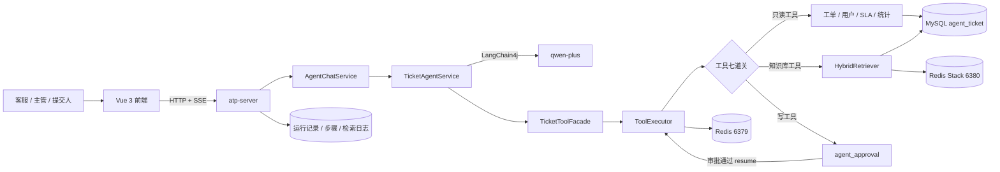
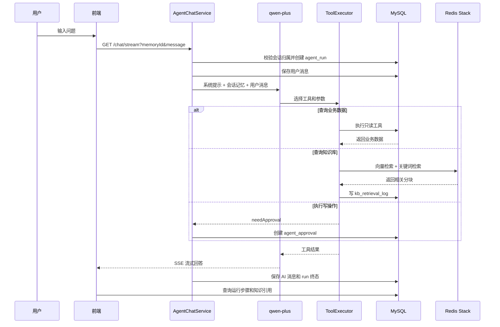
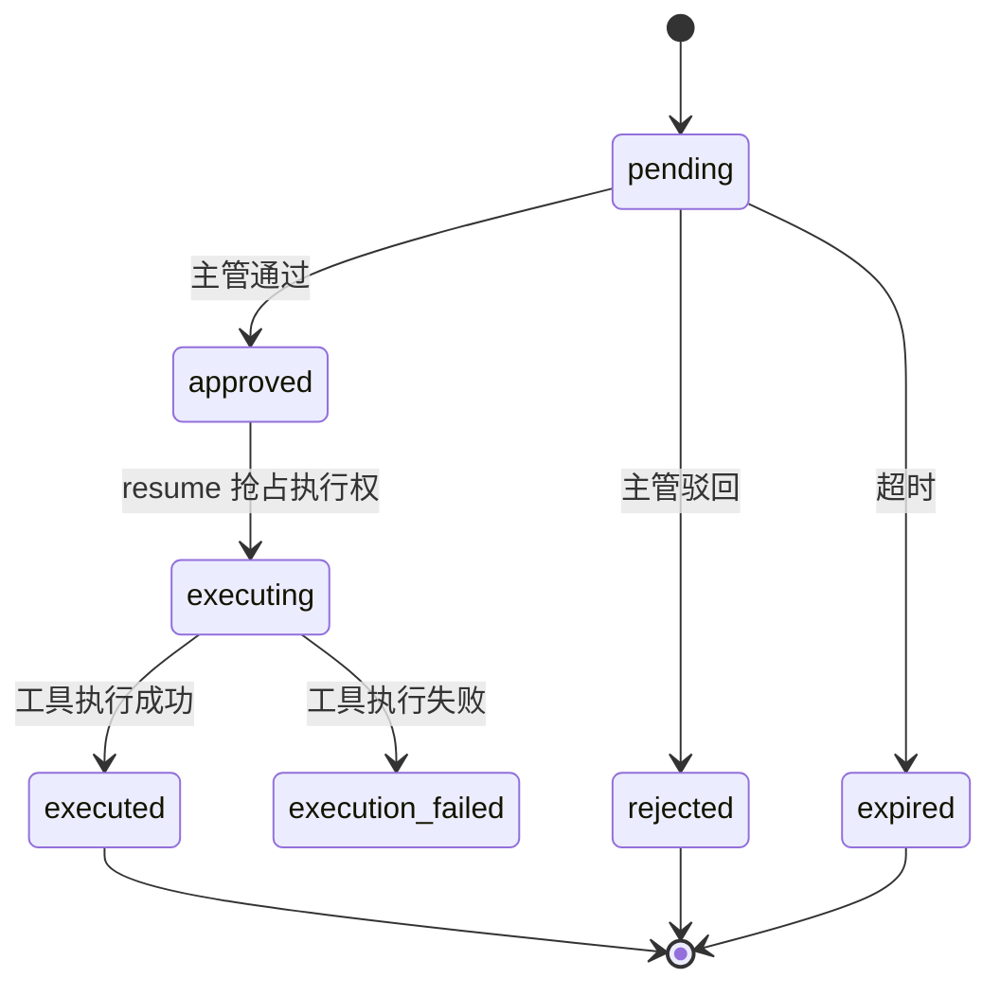

# 智能工单 · 客服 Agent 平台

一个面向客服与售后团队的任务型 Agent 平台。用户用自然语言提出请求，Agent 查询真实工单、调用知识库、执行受控工具；涉及写操作时生成审批单，主管审批后才真正执行，并把运行过程、工具步骤、知识引用和审批结果持久化。

> 这不是“套了聊天框的问答机器人”，而是把  
> **对话 → 工具调用 → 业务查询 → 知识检索 → 人工审批 → 执行 → 审计**  
> 串成一条可追踪的业务链路。


---

## 目录

- [项目解决的问题](#项目解决的问题)
- [核心能力](#核心能力)
- [角色与业务对象](#角色与业务对象)
- [系统架构](#系统架构)
- [一次对话的完整链路](#一次对话的完整链路)
- [工具执行器](#工具执行器)
- [审批生命周期](#审批生命周期)
- [RAG 知识库](#rag-知识库)
- [数据模型](#数据模型)
- [模块与目录](#模块与目录)
- [技术栈](#技术栈)
- [界面展示](#界面展示)
- [快速开始](#快速开始)
- [配置说明](#配置说明)
- [数据库初始化](#数据库初始化)
- [演示数据](#演示数据)
- [API 一览](#api-一览)
- [前端页面](#前端页面)
- [测试与构建](#测试与构建)
- [安全设计](#安全设计)
- [当前边界](#当前边界)
- [后续计划](#后续计划)
- [常见问题](#常见问题)
- [文档索引](#文档索引)

---

## 项目解决的问题

普通客服系统和普通聊天机器人各有一个明显缺口：

```text
传统客服系统：
人查工单 → 人判断 → 人改数据 → 人写回复
```

```text
普通聊天机器人：
模型直接生成一段看起来合理的话
```

本项目解决的是：

```text
用户自然语言提问
→ Agent 理解意图
→ 查询真实业务数据
→ 检索企业内部知识
→ 需要修改数据时先审批
→ 审批后执行并记录结果
```

### 典型场景

```text
用户：帮我查一下待受理的工单
Agent：ticket_query
结果：返回真实工单号、状态、优先级、处理人和 SLA
```

```text
用户：餐里有异物应该怎么处理？
Agent：kb_search
结果：Redis Stack 混合检索命中《食品安全与投诉升级规范》
```

```text
用户：把工单 TK202610130001 指派给李四
Agent：先复述操作 → 调用 ticket_assign
结果：生成 pending 审批单，不直接修改工单
主管：通过并继续
系统：resume → executeApproved → 真正执行
```

---

## 核心能力

| 能力 | 状态 | 说明 |
|---|---|---|
| 多轮对话 | ✅ | LangChain4j + qwen-plus |
| SSE 流式输出 | ✅ | 前端逐段渲染回答 |
| 会话历史 | ✅ | memoryId、会话列表、历史消息 |
| 工单业务工具 | ✅ | 查询、详情、消息、用户、SLA、统计 |
| 写操作审批 | ✅ | 写工具不会直接执行 |
| 审批后执行 | ✅ | decide → resume → executeApproved |
| 重复执行保护 | ✅ | 审批单抢占 + 幂等缓存 |
| RAG 知识库 | ✅ | 文档切分、Embedding、向量与关键词检索 |
| RRF 融合 | ✅ | 向量路和关键词路按排名融合 |
| 引用溯源 | ✅ | 文档标题、分块、分数、检索日志 |
| JWT 与 RBAC | ✅ | token、角色、权限码、数据范围 |
| 运行审计 | ✅ | agent_run、agent_run_step、检索日志、traceId |
| 外部业务系统 | ⏳ | 已设计 Provider，但尚未真正接入 |
| 在线知识文件管理 | ⏳ | 入库服务和脚本已存在，Web 管理页待完善 |
| 离线评测 | ⏳ | 设计已保留，完整跑批未实现 |

---

## 角色与业务对象

### 预置账号

| 用户名 | 密码 | 姓名 | 角色 | 说明 |
|---|---|---|---|---|
| `admin` | `123456` | 系统管理员 | admin | 全部权限，可审批 |
| `zhangsan` | `123456` | 张三 | supervisor | 主管，可审批 |
| `lisi` | `123456` | 李四 | agent | 内部客服，可处理工单 |
| `wangwu` | `123456` | 王五 | agent | 内部客服，可处理工单 |
| `zhaoliu` | `123456` | 赵六 | requester | 工单提交人 |

### 三个身份必须区分

```text
提交人 requester：
发起工单，只能查看自己的工单。

处理人 agent：
客服，可查看和执行自己权限范围内的工单操作。

审批人 supervisor/admin：
对 Agent 写操作进行人工审批。
```

注意：

- 李四是**内部客服**，不是外部外卖顾客。
- 赵六是当前演示中的**工单提交人**。
- 当前项目还没有独立的外部顾客实体；后续接入外卖平台时，外部顾客应来自外部业务系统，不能和 `sys_user` 混用。

---

## 系统架构



### 部署边界

```text
agent-ticket-platform     前后端单仓库
web                       前端工程
sky-take-out - 副本       可选外部业务系统，不参与当前主线启动
```

外部系统应通过适配器接入，不复制外部系统的 Entity、Mapper 或数据库。

---

## 一次对话的完整链路



### 会话 memoryId

```text
memoryId = userId:sessionId
例如：5:7
```

用途：

- 绑定 LangChain4j 会话记忆；
- 校验会话归属；
- 在工具执行时恢复当前用户身份；
- 关联运行记录和审批单。

---

## 工具执行器

所有工具统一经过 `ToolExecutor`，顺序固定。

```text
1. 工具存在性
2. Agent 工具授权范围
3. 用户权限码
4. 幂等缓存
5. 人工审批
6. 执行：超时 + 有条件的重试
7. 审计与运行步骤
```

### 工具分类

| 类型 | 工具 |
|---|---|
| 只读 | `ticket_query`、`ticket_detail`、`ticket_message_list`、`user_query`、`sla_status_query`、`stats_query` |
| 知识库 | `kb_search`、`faq_search` |
| 写操作 | `ticket_create`、`ticket_assign`、`ticket_update_status`、`ticket_reply`、`ticket_escalate` |
| 外部占位 | `external_dish_query`、`external_order_query` |

### 写操作保护

```text
read_only = 0
need_approval = 1
max_retry = 0
```

写工具即使被模型调用，也只会：

```text
返回 needApproval
→ 创建 agent_approval
→ 等待人工处理
```

不会直接修改业务数据。

### 幂等

- 只读工具允许有限重试。
- 写工具不自动重试。
- 审批执行以审批单 ID 作为稳定幂等作用域。
- 同一张审批单重复 resume 不会重复执行。

---

## 审批生命周期



### 审批 API

```text
GET  /approvals
GET  /approvals/by-run/{runId}
POST /approvals/decide
POST /approvals/{id}/resume
```

审批权限：

```text
ticket:approve
```

当前预置角色中，`admin` 和 `zhangsan` 拥有审批权限。

### 一个常见误解

审批单审批的是**具体写工具调用**，不是抽象审批流程。

例如：

```text
ticket_assign 审批通过
→ resume 直接完成指派
```

不是“审批通过后再手动进入工单管理重新指派”。

---

## RAG 知识库

### 入库链路

```text
PDF / Markdown / TXT
→ 文件解析
→ 500 字切分，100 字重叠
→ SHA-256 去重
→ text-embedding-v3 生成 1024 维向量
→ Redis Stack JSON 写入
→ MySQL kb_document / kb_chunk
→ 状态 pending → processing → ready/failed
```

### 查询链路

```text
用户问题
→ 向量路检索
→ 关键词路检索
→ RRF 融合
→ 返回 topK 分块
→ 写 kb_retrieval_log
→ 交给模型生成回答
→ 通过 runId 查询结构化引用
```

### Redis 索引

```text
索引名：embedding-index
类型：JSON
前缀：embedding:
文本字段：$.text
向量字段：$.vector
标题字段：$.doc_title
```

### 知识源

```text
docs/knowledge-base/
├── 01-refund-policy.md
├── 02-delivery-exceptions.md
├── 03-sla-and-ticket.md
├── 04-account-coupon-invoice.md
├── 05-external-takeout.md
└── 06-food-safety.md
```

### 入库命令

Docker 模式：

```powershell
& '.\tools\seed-knowledge-base.ps1' -RedisMode docker
```

WSL 临时模式：

```powershell
& '.\tools\seed-knowledge-base.ps1' -RedisMode wsl
```

详细操作与代码：

[知识库操作手册](docs/09-知识库操作手册.md)

---

## 数据模型

### 业务表

| 表 | 作用 |
|---|---|
| `ticket` | 工单主表 |
| `ticket_message` | 工单沟通消息 |
| `ticket_status_log` | 状态流转日志 |
| `ticket_category` | 工单分类 |
| `sla_policy` | SLA 策略 |
| `sla_timer` | SLA 计时器 |
| `sla_escalation_log` | SLA 升级记录 |
| `ticket_attachment` | 附件元数据 |

### Agent 表

| 表 | 作用 |
|---|---|
| `agent` | Agent 定义和工具授权范围 |
| `agent_tool` | 工具元数据 |
| `agent_session` | 会话 |
| `agent_message` | 会话消息 |
| `agent_run` | 一次提问对应一次运行 |
| `agent_run_step` | 工具和节点运行步骤 |
| `agent_approval` | 写操作审批单 |

### 知识库表

| 表 | 作用 |
|---|---|
| `kb_document` | 知识文档 |
| `kb_chunk` | 文档分块和向量元数据 |
| `kb_faq` | FAQ 词条 |
| `kb_retrieval_log` | 检索记录和评测证据 |

### 权限表

| 表 | 作用 |
|---|---|
| `sys_user` | 用户 |
| `sys_role` | 角色 |
| `sys_permission` | 权限点 |
| `sys_user_role` | 用户角色关系 |
| `sys_role_permission` | 角色权限关系 |

---

## 模块与目录

### 仓库与模块

```text
agent-ticket-platform
├── atp-common       统一响应、异常、常量、通用工具
├── atp-pojo         实体、DTO、VO、查询对象
├── atp-agent        Agent 内核、工具契约、记忆、审批、RAG
├── atp-eval         评测模块
├── atp-server       Web 接口、业务工具实现、启动模块
├── web              Vue 3 前端工程
├── docs             设计文档、知识库源文件和截图
├── sql              建库和初始化数据
└── tools            演示数据与知识库脚本
```

### 关键后端目录

```text
atp-agent/src/main/java/com/atp/agent/
├── config/          Agent、记忆、知识库配置
├── mapper/          agent / kb 域 Mapper
├── rag/             混合检索、RRF、检索结果模型
├── service/         对话、会话、运行、入库、审批
└── tool/            工具契约、执行器、注册表、门面

atp-server/src/main/java/com/atp/server/
├── agent/tool/impl/ 业务工具实现
├── aspect/          权限切面
├── config/          Web、MVC、指标配置
├── controller/      REST 接口
├── filter/          traceId
├── interceptor/     JWT
├── mapper/          ticket / sys Mapper
├── properties/      配置属性
├── service/         业务服务
├── statemachine/    工单状态机
└── task/            SLA 巡检、审批过期任务
```

---

## 技术栈

| 层 | 技术 |
|---|---|
| 语言 | Java 21 |
| 后端 | Spring Boot 3.5、Spring MVC、MyBatis、PageHelper、Druid |
| Agent | LangChain4j 1.0.1-beta6、Reactor |
| 模型 | 阿里云百炼 `qwen-plus` |
| Embedding | `text-embedding-v3`，1024 维 |
| 数据库 | MySQL 8 |
| 缓存 | Redis 7 |
| 向量库 | Redis Stack、RediSearch、ReJSON |
| 认证 | JWT |
| 密码 | BCrypt |
| 文档解析 | Apache PDFBox |
| 前端 | Vue 3、Vite、Element Plus、Pinia、Vue Router |
| 可观测 | Actuator、Prometheus、traceId |

---

## 界面展示

### 对话工作台

- SSE 流式输出；
- 工具调用；
- 运行轨迹；
- 知识库引用。


### 工单管理

- 状态、优先级、处理人筛选；
- SLA 剩余时间；
- 工单详情、状态流转、指派、回复。


### 知识库检索

- hybrid / vector / keyword；
- RRF 融合；
- 返回文档标题、分块和分数。


### 审批中心

- pending / approved / rejected / expired / execution_failed；
- 通过并 resume；
- 查看审批参数和运行轨迹。


---

## 快速开始

### 1. 前置环境

```text
JDK 21
Maven 3.9+
MySQL 8
Redis 7
Redis Stack（包含 search 和 ReJSON 模块）
Node.js 18+
```

默认端口：

```text
MySQL       3306
Redis       6379
Redis Stack 6380
后端        18096
前端        5174
```

### 2. 数据库初始化

```powershell
cd 'E:\Java\java_code\agent-ticket-platform'
mysql -uroot -p123456 --default-character-set=utf8mb4 -e "source sql/00-drop-all.sql"
mysql -uroot -p123456 --default-character-set=utf8mb4 -e "source sql/01-schema.sql"
mysql -uroot -p123456 --default-character-set=utf8mb4 -e "source sql/02-init-data.sql"
mysql -uroot -p123456 --default-character-set=utf8mb4 -e "source sql/03-eval-data.sql"
```

`00-drop-all.sql` 会删除数据库，只用于重建环境。

### 3. 启动 Redis Stack

```powershell
docker start redis-vector
docker exec redis-vector redis-cli PING
docker exec redis-vector redis-cli MODULE LIST
```

预期能看到：

```text
PONG
name search
name ReJSON
```

### 4. 配置环境变量

```powershell
${env:QW-API-KEY} = [Environment]::GetEnvironmentVariable('QW-API-KEY','User')
```

IDEA 必须使用 JDK 21，并且在设置环境变量后重新启动 IDEA，否则可能读不到 `QW-API-KEY`。

### 5. 启动后端

```powershell
mvn -pl atp-server -am -DskipTests package `
  "-Dmaven.repo.local=E:\Java\maven-LocalRepository"

java -jar atp-server\target\atp-server-1.0-SNAPSHOT.jar
```

健康检查：

```powershell
Invoke-RestMethod 'http://127.0.0.1:18096/actuator/health'
```

预期：

```json
{"status":"UP"}
```

IDEA 运行主类：

```text
com.atp.AtpApplication
```

启动模块：

```text
atp-server
```

### 6. 启动前端

```powershell
cd '.\web'
npm ci
npm run dev
```

访问：

```text
http://127.0.0.1:5174
```

### 7. 登录

```text
admin / 123456
或
zhangsan / 123456
```

---

## 配置说明

真实配置：

```text
atp-server/src/main/resources/application-dev.yml
```

模板：

```text
atp-server/src/main/resources/application-dev.yml.example
```

真实配置不入库。

### 关键配置

```yaml
langchain4j:
  open-ai:
    chat-model:
      api-key: ${QW-API-KEY}
      model-name: qwen-plus
      max-retries: 2
      timeout: 90s
    streaming-chat-model:
      api-key: ${QW-API-KEY}
      model-name: qwen-plus
      max-retries: 2
      timeout: 90s
    embedding-model:
      api-key: ${QW-API-KEY}
      model-name: text-embedding-v3
```

### Redis 用途分离

```text
6379：权限缓存、工具幂等
6380：知识库向量和 RediSearch 索引
```

---

## 演示数据

### 工单

当前演示库包含工单、消息和状态流转记录，覆盖：

- 订单超时；
- 退款未到账；
- 优惠券异常；
- 账号冻结；
- 餐品缺失；
- 发票修改；
- 骑手失联；
- 会员积分；
- 食品安全。

初始化脚本：

```powershell
& '.\tools\seed-demo-tickets.ps1'
```

### 知识库

```text
6 篇知识文档
7 个向量分块
6 条 FAQ
索引失败数 0
```

### 审批演示

```text
1. 用有 ticket:assign 权限的用户发起写操作
2. 生成 pending 审批单
3. 用 zhangsan 或 admin 审批
4. resume 后查看工单是否变化
```

---

## API 一览

### 登录与用户

| 方法 | 路径 | 说明 |
|---|---|---|
| POST | `/login` | 登录 |
| POST | `/logout` | 退出 |
| GET | `/auth/me` | 当前用户角色和权限 |
| GET | `/users/all` | 用户列表 |

### 会话与对话

| 方法 | 路径 | 说明 |
|---|---|---|
| POST | `/agents/sessions` | 创建会话 |
| GET | `/agents/sessions` | 会话列表 |
| GET | `/agents/sessions/messages` | 历史消息 |
| DELETE | `/agents/sessions` | 删除会话 |
| GET | `/agents/sessions/latest-run` | 最近一次运行 |
| GET | `/chat/stream` | SSE 对话 |

### 运行轨迹

| 方法 | 路径 | 说明 |
|---|---|---|
| GET | `/agents/runs/{id}` | 运行详情 |
| GET | `/agents/runs/{id}/steps` | 工具运行步骤 |
| GET | `/agents/runs/{id}/references` | 知识库引用 |

### 审批

| 方法 | 路径 | 说明 |
|---|---|---|
| GET | `/approvals` | 分页查询 |
| GET | `/approvals/by-run/{runId}` | 一次运行的审批 |
| POST | `/approvals/decide` | 通过或驳回 |
| POST | `/approvals/{id}/resume` | 执行已通过审批 |

### 工单

| 方法 | 路径 | 说明 |
|---|---|---|
| GET | `/tickets` | 工单分页 |
| GET | `/tickets/{id}` | 工单详情 |
| GET | `/tickets/{id}/history` | 状态历史 |
| POST | `/tickets` | 创建工单 |
| PUT | `/tickets/{id}/status` | 状态流转 |
| PUT | `/tickets/{id}/assignee` | 指派 |
| PUT | `/tickets/{id}/priority` | 优先级 |
| POST | `/tickets/{id}/replies` | 回复 |
| DELETE | `/tickets/{id}` | 逻辑删除 |

### 知识库

| 方法 | 路径 | 说明 |
|---|---|---|
| POST | `/kb/test-retrieve` | 混合检索测试 |

### 鉴权头

```text
token: <JWT>
```

---

## 前端页面

| 路由 | 页面 | 权限 |
|---|---|---|
| `/login` | 登录 | 公共 |
| `/chat` | 对话工作台 | 登录 |
| `/tickets` | 工单管理 | `ticket:list` |
| `/tickets/:id` | 工单详情 | `ticket:list` |
| `/approvals` | 审批中心 | `ticket:approve` |
| `/kb` | 知识库 | `kb:read` |

前端通过 Vite 代理访问后端：

```text
/api/* → http://127.0.0.1:18096/*
```

---

## 测试与构建

### 后端测试

```powershell
mvn -pl atp-server -am test `
  "-Dmaven.repo.local=E:\Java\maven-LocalRepository"
```

覆盖：

- `ToolExecutorTest`：权限、幂等、审批、已审批执行；
- `ApprovalServiceImplTest`：审批执行上下文恢复；
- `KbIngestServiceTest`：入库失败状态；
- `RrfFuserTest`：RRF 融合。

### 前端构建

```powershell
cd '.\web'
npm run build
```

---

## 安全设计

- 真实配置和 API Key 不提交 Git；
- 密码使用 BCrypt；
- JWT 校验用户身份；
- 权限码控制接口和工具；
- 提交人只能查看自己的工单；
- Agent 工具执行不依赖 ThreadLocal；
- 写工具必须人工审批；
- 审批执行有幂等保护；
- 外部系统不共享数据库；
- 日志不记录完整敏感信息；
- 每个请求使用 traceId 串联日志。

---

## 当前边界

### 已完整实现

```text
工单与 SLA
Agent 对话与工具调用
写操作审批
知识库入库与混合检索
引用溯源
运行轨迹
登录、权限、数据隔离
```

### 尚未完成

```text
外部外卖业务系统真实接入
完整在线知识库管理页面
离线评测、LLM Judge、回归对比
生产级监控告警
外部系统写操作
```

### 重要说明

当前演示主要使用内置业务数据。  
外部订单、配送和退款查询需要后续通过 Provider 适配器接入 `sky-take-out - 副本`。

---

## 后续计划

1. 通过 Provider 适配器接入外卖订单、配送和退款只读能力。
2. 增加 Agent 操作回执，展示工具调用、知识来源、审批和执行结果。
3. 完善知识库 Web 上传、正文查看、删除和重新入库。
4. 增加 20～30 条固定评测用例和回归指标。
5. 接入外部写操作审批与幂等控制。

---

## 常见问题

### 后端启动失败：端口占用

```powershell
Get-NetTCPConnection -LocalPort 18096 -State Listen
```

停止占用端口的进程，或在 IDEA 中重启应用。

### `QW-API-KEY` 未配置

确认环境变量：

```powershell
[Environment]::GetEnvironmentVariable('QW-API-KEY','User')
```

设置后重新启动 IDEA。

### Redis Stack 连接失败

```powershell
docker ps --filter "name=redis-vector"
docker exec redis-vector redis-cli PING
docker exec redis-vector redis-cli MODULE LIST
```

### 前端显示 500

检查顺序：

```text
1. 后端 18096 是否启动
2. IDEA 是否读到 QW-API-KEY
3. 百炼接口网络是否稳定
4. 查看后端日志和 agent_run.error_msg
```

### 审批中心没有操作按钮

只有状态为 `pending` 的审批单显示“通过/驳回”。  
`expired`、`executed`、`rejected` 都不显示操作按钮。

### Agent 回答的工单状态是旧的

进度类问题必须重新查询数据库。  
检查 `agent_run_step` 是否包含 `ticket_query` 或 `ticket_detail`。

---

## 文档索引

- [前端运行说明](web/README.md)
- [知识库操作手册](docs/09-知识库操作手册.md)
- [外部业务系统接入与切换手册](docs/10-外部业务系统接入与切换手册.md)
- [Redis 索引设计](docs/design/06-Redis索引.md)
- [工具清单](docs/design/02-工具清单.md)
- [工具实现对照表](docs/design/08-工具实现对照表.md)
- [遗留问题](docs/design/07-遗留问题.md)

仓库外项目流程手册：

```text
E:\Java\java_code\docs\05-项目二操作流程手册.md
```

---

## 项目定位总结

```text
传统客服系统：人查数据、人改工单、人写回复。
普通聊天机器人：模型直接生成回答。

本项目：模型理解问题、调用受控工具、使用知识证据、
       写操作等人工审批、执行结果可追踪。
```

项目的目标不是替代客服，而是让 Agent 成为可审计、可审批、可追踪的客服执行助手。


