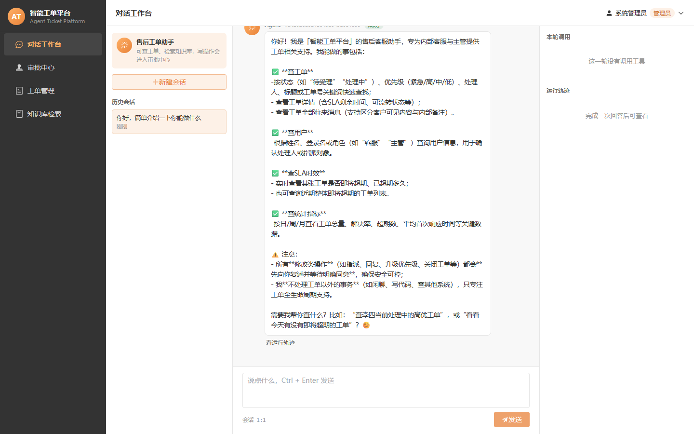
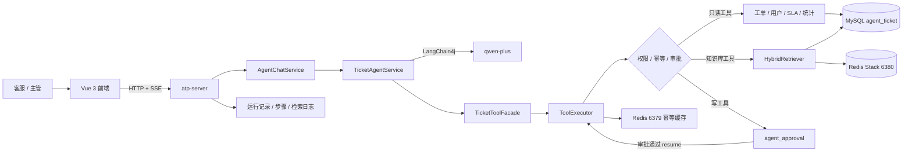
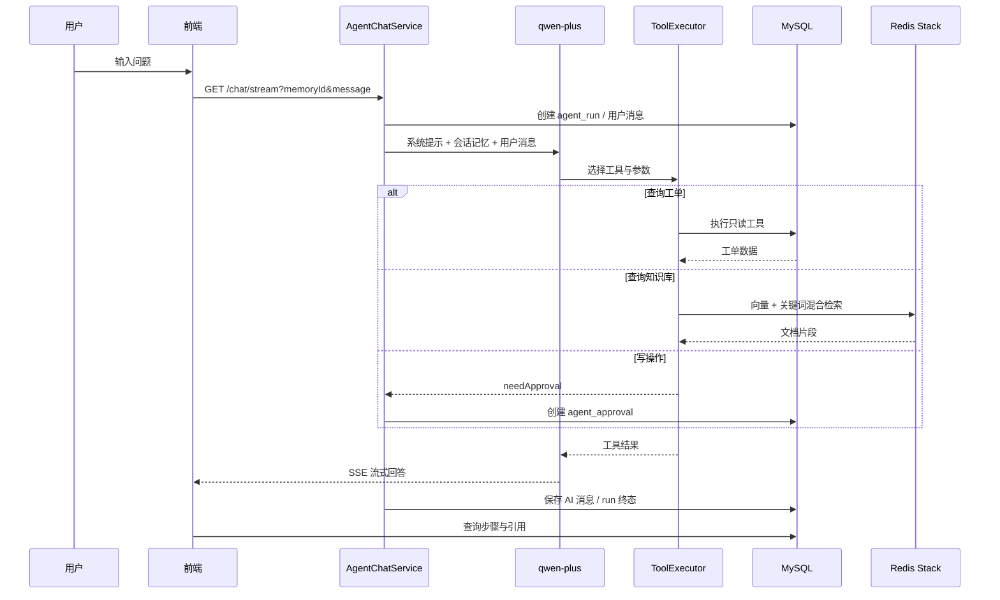
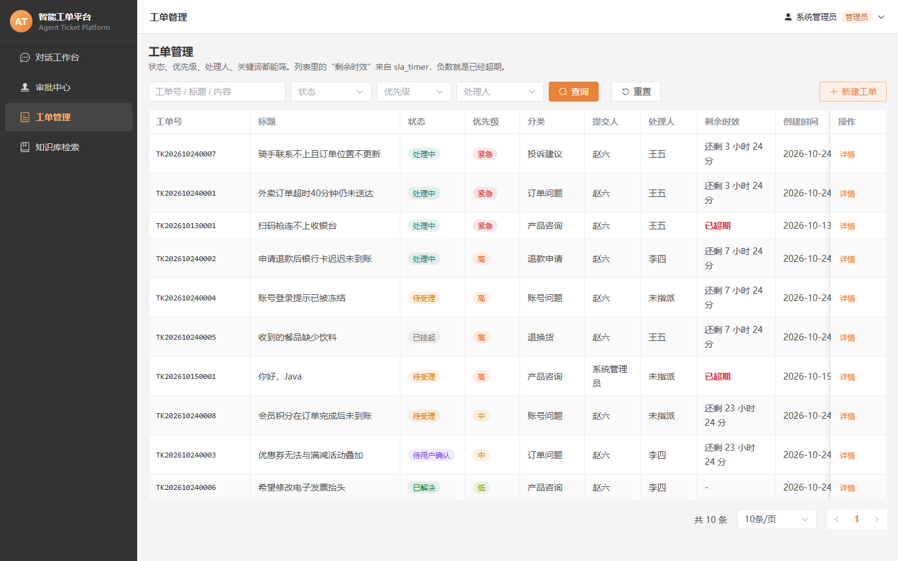
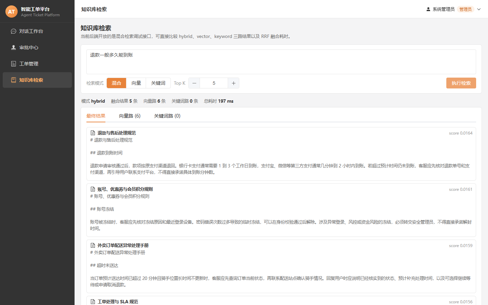
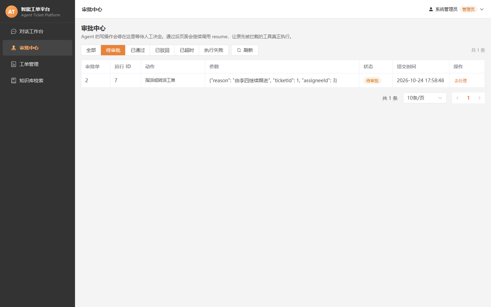

# 智能工单 · 客服 Agent 平台

一个面向客服团队的任务型 Agent 平台：用户用自然语言提出需求，Agent 查询真实工单与知识库，涉及写操作时生成审批单，主管审批后才执行，并把整条运行链路持久化。

它不是“套了聊天框的问答机器人”，而是把 **对话 → 工具调用 → 业务查询 → 知识检索 → 人工审批 → 执行 → 审计** 串成可追踪的业务流程。



---

## 这个项目到底在做什么

举三个实际例子：

```text
“帮我查一下待受理的工单”
→ Agent 调用 ticket_query
→ 查询 MySQL 中的真实工单
→ 返回工单号、状态、优先级和处理人
```

```text
“餐里有异物应该怎么处理？”
→ Agent 调用 kb_search
→ Redis Stack 混合检索知识库
→ 基于命中的制度片段回答，并保存引用
```

```text
“把工单 TK202610130001 指派给李四”
→ Agent 先确认用户意图
→ 调用 ticket_assign
→ 生成待审批单，不直接修改工单
→ 主管审批通过后 resume 真正执行
```

核心区别：

- 普通聊天机器人：生成一段看起来合理的话。
- 本项目：查询业务事实、使用知识证据、执行受控工具，并留下审计记录。

---

## 核心能力

- **工单 Agent**：基于 LangChain4j + `qwen-plus`，支持流式回答和多轮会话。
- **真实业务工具**：工单查询、详情、消息、用户、SLA、统计等只读工具。
- **写操作审批**：创建、指派、流转、回复、升级等写工具不会直接执行。
- **审批后执行**：`decide → resume → executeApproved`，并带重复执行保护。
- **RAG 知识库**：文档切分、SHA-256 去重、Embedding、向量检索、关键词检索、RRF 融合。
- **引用溯源**：回答可反查命中的文档标题、分块和分数。
- **权限与数据隔离**：JWT、`@RequirePermission`、工单提交人数据范围控制。
- **运行审计**：`agent_run`、`agent_run_step`、`kb_retrieval_log`、审批记录和 traceId。
- **统一错误响应**：成功、业务失败、未登录、无权限都有固定结构。

---

## 系统架构



### 技术栈

| 层 | 技术 |
|---|---|
| 语言 | Java 21 |
| 后端 | Spring Boot 3.5、MyBatis、PageHelper、Druid |
| Agent | LangChain4j 1.0.1-beta6、Reactor、qwen-plus |
| 数据库 | MySQL 8 |
| 缓存 | Redis 7（权限缓存、工具幂等） |
| 向量库 | Redis Stack、RediSearch、ReJSON |
| 前端 | Vue 3、Vite、Element Plus、Pinia |
| 可观测 | Actuator、Prometheus、traceId |

---

## 一次对话的完整链路



---

## 界面展示

### 工单管理

真实分页、状态、优先级、处理人和 SLA 数据。



### 知识库混合检索

可查看 hybrid、vector、keyword 三路结果及 RRF 融合分数。



### 审批中心

Agent 的写操作先进入待审批，不会绕过人工直接修改数据。



---

## 模块结构

```text
agent-ticket-platform
├── atp-common       统一响应、异常、常量、通用工具
├── atp-pojo         实体、DTO、VO、查询对象
├── atp-agent        Agent 内核、工具契约、记忆、审批、RAG
├── atp-eval         评测相关模块
└── atp-server       Web 接口、业务工具实现、应用启动模块
```

---

## 快速开始

### 1. 前置环境

- JDK 21
- Maven 3.9+
- MySQL 8
- Redis 7，默认 `127.0.0.1:6379`
- Redis Stack，默认 `127.0.0.1:6380`
- 阿里云百炼 API Key，环境变量名 `QW-API-KEY`

### 2. 配置

复制配置模板：

```powershell
Copy-Item `
  'atp-server\src\main\resources\application-dev.yml.example' `
  'atp-server\src\main\resources\application-dev.yml'
```

设置环境变量：

```powershell
${env:QW-API-KEY} = [Environment]::GetEnvironmentVariable('QW-API-KEY','User')
```

真实配置和真实 Key 不应提交到 Git。

### 3. 初始化数据库

```powershell
mysql -uroot -p123456 --default-character-set=utf8mb4 -e "source sql/00-drop-all.sql"
mysql -uroot -p123456 --default-character-set=utf8mb4 -e "source sql/01-schema.sql"
mysql -uroot -p123456 --default-character-set=utf8mb4 -e "source sql/02-init-data.sql"
mysql -uroot -p123456 --default-character-set=utf8mb4 -e "source sql/03-eval-data.sql"
```

`00-drop-all.sql` 会删除数据库，只用于重建环境。

### 4. 启动 Redis Stack

Docker 正常时：

```powershell
docker start redis-vector
docker exec redis-vector redis-cli PING
docker exec redis-vector redis-cli MODULE LIST
```

必须能看到 `search` 和 `ReJSON` 模块。

### 5. 构建并启动后端

```powershell
mvn -pl atp-server -am -DskipTests package "-Dmaven.repo.local=E:\Java\maven-LocalRepository"
java -jar atp-server\target\atp-server-1.0-SNAPSHOT.jar
```

健康检查：

```powershell
Invoke-RestMethod 'http://127.0.0.1:18096/actuator/health'
```

预期：

```json
{"status":"UP"}
```

### 6. 启动前端

前端工程：

```text
E:\Java\java_code\atp-reference-web
```

```powershell
cd 'E:\Java\java_code\atp-reference-web'
npm install
npm run dev
```

访问：

```text
http://127.0.0.1:5174
```

### 7. 登录

| 用户名 | 密码 | 角色 |
|---|---|---|
| `admin` | `123456` | 管理员 |
| `zhangsan` | `123456` | 主管 |
| `lisi` | `123456` | 客服 |
| `wangwu` | `123456` | 客服 |
| `zhaoliu` | `123456` | 提交人 |

---

## 核心接口

| 接口 | 用途 |
|---|---|
| `POST /login` | 登录并签发 token |
| `GET /auth/me` | 获取当前用户角色与权限 |
| `POST /agents/sessions` | 创建会话 |
| `GET /agents/sessions` | 会话列表 |
| `GET /agents/sessions/messages` | 历史消息 |
| `GET /chat/stream` | SSE 流式对话 |
| `GET /agents/runs/{id}/steps` | 运行轨迹 |
| `GET /agents/runs/{id}/references` | 知识库引用 |
| `GET /approvals` | 审批列表 |
| `POST /approvals/decide` | 审批通过或驳回 |
| `POST /approvals/{id}/resume` | 审批后执行 |
| `POST /kb/test-retrieve` | 混合检索测试 |
| `GET /tickets` | 工单分页查询 |

请求头鉴权使用：

```text
token: <JWT>
```

---

## 知识库

### 当前能力

- Markdown / TXT / PDF 文件解析
- 500 字切分，100 字重叠
- SHA-256 去重
- `text-embedding-v3` 1024 维向量
- Redis Stack JSON 向量索引
- 向量 + 关键词混合检索
- RRF 融合
- Agent 通过 `kb_search` 使用知识
- 引用查询和检索日志

### 入库操作

```powershell
& '.\tools\seed-knowledge-base.ps1' -RedisMode docker
```

Docker 不可用时可临时使用 WSL Redis：

```powershell
& '.\tools\seed-knowledge-base.ps1' -RedisMode wsl
```

详细步骤、代码、验证和排错：

[知识库操作手册](docs/09-知识库操作手册.md)

### 当前限制

当前 Web 页面还没有开放文档上传、纯文本添加、完整正文查看和删除。现在由管理员维护 `docs/knowledge-base/*.md` 并执行入库脚本。目标 Web 接口和前端结构已写入手册。

---

## 外部业务系统

当前 Agent 平台**没有真正连接外卖业务系统**。

数据库中的 `external_dish_query`、`external_order_query` 只是占位工具元数据，尚未实现 Provider，也没有加入 `TicketToolFacade`。

推荐方式：

```text
Agent 平台 → ExternalBusinessProvider → HTTP → sky-take-out - 副本
```

- 不复制外卖平台的 Entity、Mapper 和数据库。
- 只读能力先接订单、配送、退款查询。
- 写操作必须审批、幂等和审计。
- 切换供应商只需更换 `provider` 配置和 Provider 实现。
- 完全不同的业务使用新的能力包，不复用旧工具编码。

完整新增文件、修改文件、代码、配置、切换和回滚步骤：

[外部业务系统接入与切换手册](docs/10-外部业务系统接入与切换手册.md)

---

## 已实现与后续计划

### 已实现

- 工单、分类、消息、状态机、SLA
- JWT 登录、权限切面、数据范围控制
- LangChain4j Agent、多轮记忆、SSE
- 工具注册、权限、幂等、超时、审计
- 写操作持久化审批
- Redis Stack 知识库入库与混合检索
- 知识库引用溯源
- 前端兼容改造

### 后续计划

- 知识库 Web 上传、文本新增、正文查看和删除
- 工单号到内部 ID、姓名到用户 ID 的可靠解析层
- 外部系统只读 Provider 与审批写操作
- 更完整的 Agent 结构化事件流
- 离线评测、LLM Judge、回归对比和成本看板

---

## 测试

```powershell
mvn -pl atp-server -am test "-Dmaven.repo.local=E:\Java\maven-LocalRepository"
```

当前覆盖：

- `ToolExecutorTest`：权限、幂等、审批、已审批执行
- `ApprovalServiceImplTest`：审批执行上下文恢复
- `KbIngestServiceTest`：入库失败状态
- `RrfFuserTest`：RRF 融合

前端构建：

```powershell
cd 'E:\Java\java_code\atp-reference-web'
npm run build
```

---

## 文档索引

- 项目操作流程手册（仓库外）：`E:\Java\java_code\docs\05-项目二操作流程手册.md`
- [知识库操作手册](docs/09-知识库操作手册.md)
- [外部业务系统接入与切换手册](docs/10-外部业务系统接入与切换手册.md)
- [Redis 索引设计](docs/design/06-Redis索引.md)
- [工具清单](docs/design/02-工具清单.md)
- [工具实现对照表](docs/design/08-工具实现对照表.md)
- [遗留问题](docs/design/07-遗留问题.md)

---

## 安全说明

- 不提交 `application-dev.yml`、API Key、外部系统 token。
- 外部系统写操作必须经过审批和幂等控制。
- Agent 不直接访问外部业务数据库。
- 日志中避免记录完整手机号、身份证、支付凭证等敏感信息。
- Redis 6379 与 Redis Stack 6380 使用独立配置和独立用途。

---

## 项目定位总结

```text
传统客服系统：人查数据、人改工单、人写回复。
普通聊天机器人：模型直接生成回答。

本项目：模型理解问题、调用受控工具、使用知识证据、
       写操作等人工审批、执行结果可追踪。
```

